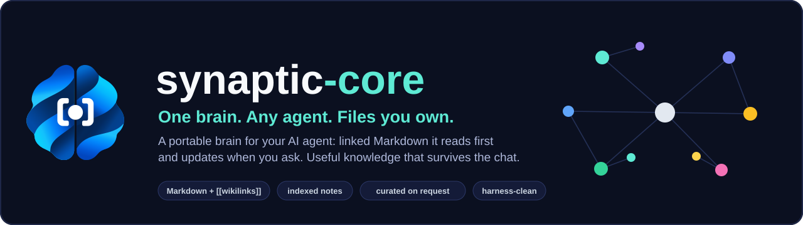
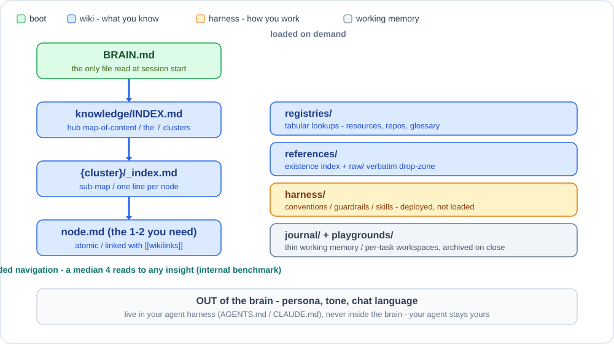

<p align="center">
  
</p>

# Synaptic

**A brain for your AI agent. Useful knowledge that survives the chat.**

Synaptic gives your agent a brain: a folder of linked Markdown files it reads first and updates
when you ask. Decisions, lessons and playbooks stay in files you own, so a fresh session, a
different agent or another person can pick the work up from them.

> **v1.7.0, usable beta.** The file-based brain works with any agent that can read and write files.
> Extras are optional previews. [Details](#what-is-automatic-and-what-is-not).

## Quickstart

Paste this into your agent, in the project where you want the brain:

```text
Install Synaptic from https://github.com/diego-alfadev/synaptic-core/releases/latest

Download the synaptic-<version>.tar.gz asset (not the "Source code" archive) and check it against
SHA256SUMS. Find any existing brain and project scope first. Stage and verify the full bundle, show
me the changes and preserve my knowledge and rules. Then run /synaptic-init and tell me which
capabilities actually work here. Do not install MCP if unavailable.
```

That is the whole install. The agent sets up the brain, asks you a few questions about the project
and offers a short guided walkthrough. It needs file access, and network access for the download.

Then:

1. Work as usual. When something is worth keeping, run `/synaptic-consolidate`.
2. Open a fresh session and ask the agent to resume. It starts from `BRAIN.md`.

Already have a brain? [Keep it and upgrade the engine](UPGRADING.md). Using VS Code? Follow
[the project setup guide](docs/integrations/vscode.md).

## The problem

- Every new chat starts from zero. You explain the project again, or the agent guesses.
- What you worked out last week lives in a transcript nobody will reread.
- Long instruction files grow until the agent stops following them.
- Switching agent or handing work to a colleague loses the context.

A brain answers with files, not a platform: one short boot file, an index, and small linked notes
the agent opens only when it needs them.

## What is in a brain

```text
.synaptic/
├── BRAIN.md          the one file read at session start
├── knowledge/
│   ├── INDEX.md      map of topic clusters
│   └── {cluster}/    one _index.md per cluster, one note per idea, linked with [[wikilinks]]
├── registries/       lookup tables: repos, resources, glossary
├── references/       source material, kept verbatim in raw/
├── harness/          conventions and guardrails for the agent
└── playgrounds/      per-task workspaces, archived on close
```

- **Plain Markdown.** Read it, edit it, diff it and version it with the tools you already use.
- **A knowledge graph you write.** Notes are the nodes and `[[wikilinks]]` are the edges, with an
  optional type from a fixed set of seven (`depends_on`, `supersedes`, `contradicts`...). Your agent
  writes edges when it captures a note, or proposes them for you to confirm; no pipeline extracts
  them behind your back. See
  [typed edges](docs/concepts/typed-edges.md).
- **Bounded reading.** The agent follows the index to the one or two notes it needs.
- **Any agent.** The brain connects through a short block in `AGENTS.md` or `CLAUDE.md`. Your
  agent's persona and tone stay outside it.
- **Honest reporting.** Setup tells you which capabilities were verified here and which were not.

<p align="center">
  
</p>

## One brain or one per project?

Either. A brain is always the same folder; what changes is where you connect it.

| You want | Connect the brain in | It is active |
|---|---|---|
| **A global brain** | your user-level `AGENTS.md` / `CLAUDE.md` | in every session, across all your projects |
| **A workspace brain** | the `AGENTS.md` at the root of a group of projects | across that group |
| **A project brain** | that project's `AGENTS.md` | only in that project |

You do not need a brain in every folder. If you are unsure, start with one global brain: knowledge
that spans projects stays in one place, and you can review it in one place. Use a project brain
when the knowledge belongs to that repository and should ship with it for the whole team.

One rule: a private brain that holds knowledge from several clients or projects must never be
committed or synced into someone else's repository. [Brain reach](docs/concepts/reach.md) explains
the model.

## Who it is for

- **Developers using coding agents** who are tired of re-explaining a project every session.
- **People who switch agents** or work across several repositories and want one brain.
- **Teams** that need handovers to survive holidays and departures. There is a
  [guide for managers and product owners](docs/FOR-MANAGERS-AND-POS.md) that assumes no developer setup.

## Daily use

Synaptic is one skill with a handful of verbs. Each verb also gets its own command so you can find
it in your agent's `/` menu without remembering the list.

| Command | Purpose |
|---|---|
| `/synaptic-init` | Initialise or wire an existing brain |
| `/synaptic-consolidate` | Turn captured work into linked knowledge |
| `/synaptic-ingest` | Distil an existing source |
| `/synaptic-audit` | Diagnose structural problems |
| `/synaptic-maintain` | Review and treat maintenance findings |
| `/synaptic-handover` | Explain recorded work from its sources |

The `/` menu depends on the host. Where there is none, ask in plain words: the commands are listed
in the block the agent already reads.

## How it compares

Synaptic sits next to other tools more often than it replaces them.

| Approach | What it is good at | Where Synaptic differs |
|---|---|---|
| One long `AGENTS.md` / `CLAUDE.md` | Rules the agent must always follow | Knowledge lives in small notes loaded on demand, not in every prompt |
| Session memory stores, such as Engram | Recalling what happened in past sessions | Curated, human-readable files you review and version |
| Vector search over documents (RAG) | Finding passages in large, uncurated corpora | A small curated set the agent navigates by index, with no embeddings to maintain |
| Planning frameworks, such as GSD | Planning and executing work | Keeps what the work taught you; the two complement each other |

## Standing on shoulders

- **[Karpathy's LLM-wiki](https://gist.github.com/karpathy/442a6bf555914893e9891c11519de94f)** is the
  origin of the pattern: compile what you learn into a curated wiki the model reads.
- **[Engram](https://github.com/Gentleman-Programming/engram)** inspired the rule that files are the
  source of truth and anything else is a cache. Synaptic runs well alongside it.
- **[gentle-ai](https://github.com/Gentleman-Programming/gentle-ai)** shaped how Synaptic wires into
  an agent setup without taking it over.

The full list is in [credits and related work](docs/CREDITS.md).

## Optional local tools

[Cortex](docs/concepts/cortex-local.md) provides a CLI and a read-only stdio MCP server for
current-file reads, lexical search and structural status. It uses Node; its disposable index needs
no model API.

The optional [Codex automatic-curation adapter](docs/integrations/codex-curation.md) is under
preparation. Its native-event acceptance must pass before support is claimed. It curates selected
saved sources into drafts; unsaved chat facts and wiki promotion are separate work.

## What is automatic and what is not

Curation happens when you ask for it. Anything automatic is optional and is reported separately,
with what was actually observed.

| Behaviour | Executor | Trigger and evidence |
|---|---|---|
| Resume retained work | Agent reads source files | Request or verified host entry; fresh-session resume drill |
| Record activity | Capture script | An enabled, genuinely fired native hook; persisted event evidence |
| Search, read and inspect | Optional Node CLI | Explicit invocation; result checked against current files |
| Expose read-only tools | Optional MCP server | Registered host connection; actual discovery and tool call |
| Curate useful knowledge | Agent | Explicit request, or a separately verified event-driven workflow; saved source-linked result |

**MCP is optional.** With no MCP, use files and skills. A configured file or an instruction to
remember is not proof of automation. Setup shows each capability as **verified as of a time**,
**not enabled**, **needs checking**, **unavailable here** or **failed/pending**.
[How it works](HOW-IT-WORKS.md) explains this with examples.

Good to know:

- Model judgment is fallible. Keep provenance, bounded changes and a recoverable history.
- The graph is authored, not extracted. The agent navigates it by following links; Synaptic does
  not run graph queries over it.
- No model-quality or cost advantage has been measured by the offline benchmark pilot.
- Stable is gated on the VS Code pilot and a demonstrated bounded automatic-curation profile.
  See the [release notes](RELEASE-NOTES.md).

## Learn more

- [How it works](HOW-IT-WORKS.md) and the [operating contract and release gates](docs/OPERATING-MODEL.md)
- [Concept map](docs/concepts/_index.md) and [brain reach](docs/concepts/reach.md)
- [Executable checks and evidence limits](tests/README.md)
- [Owner handoff: prepare assets and create a draft with gh](docs/RELEASING.md)
- [Changelog](CHANGELOG.md) and [roadmap](ROADMAP.md)

MIT licensed. Bug reports, examples and verified host integrations are welcome.
